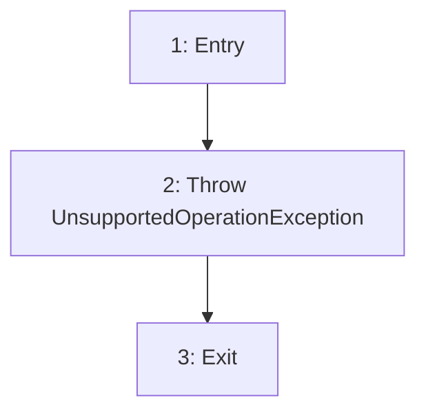
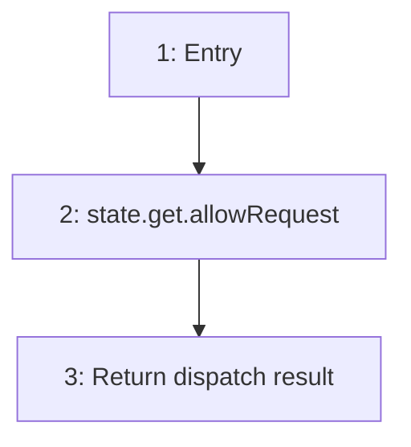
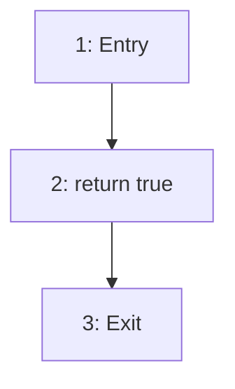
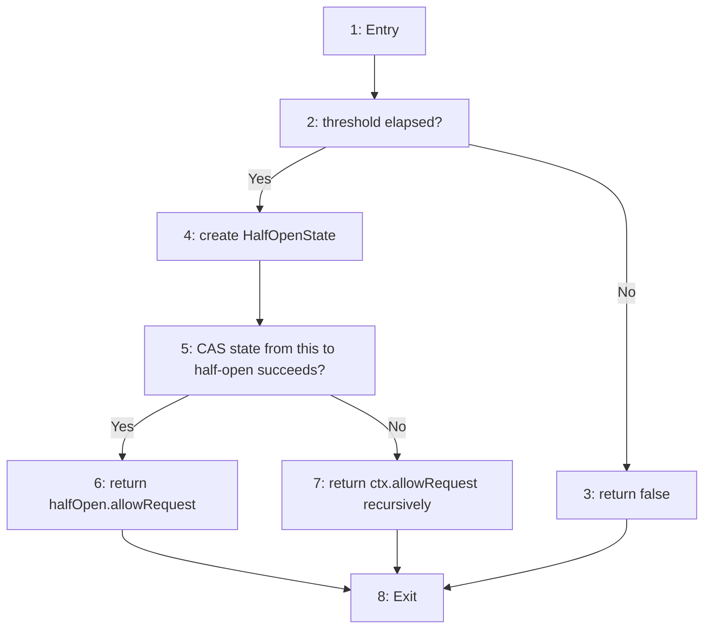
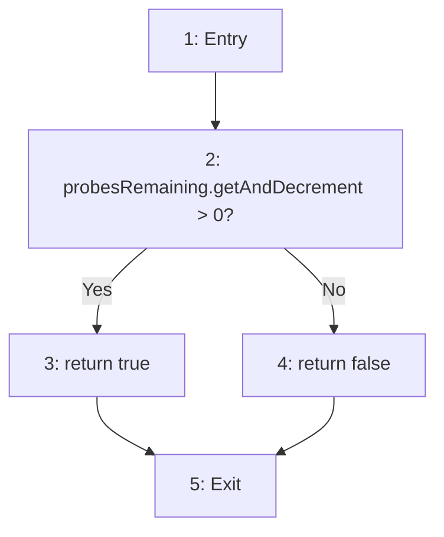
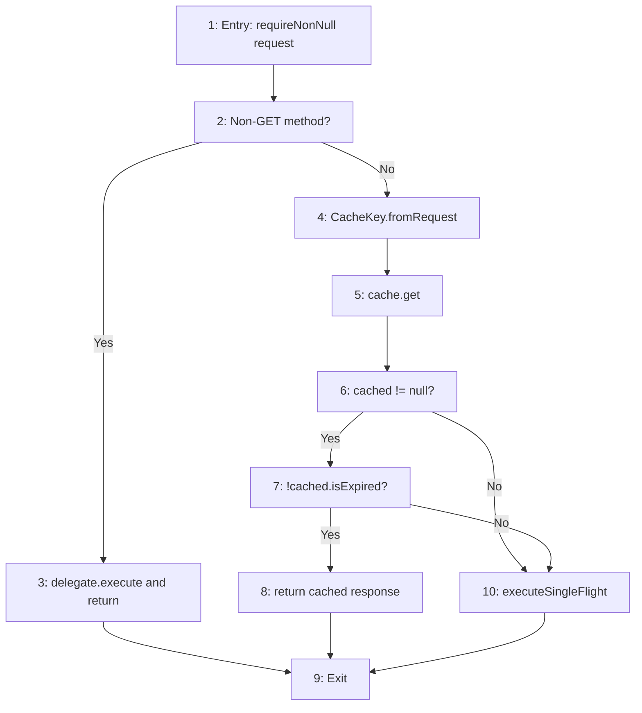

# M2 White-Box Test Design

Audit date: 2026-11-22

## Source and repository state

- Repository revision: `2780b4c9da3db887c89ebe58c392c61bc99ae3e6` (`2780b4c Add dummy upstream test fixtures`).
- The cache implementation has one local, uncommitted fix for oversized `max-age` values; the branch and commit for the remainder of the implementation are as listed below.
- JUnit evidence is taken only from test methods present under `gateway-core/src/test/java`.

## 1. `RateLimitFilter.doFilter()` — BLOCKED

- Source: [RateLimitFilter.java](../../../gateway-core/src/main/java/com/mag/core/filter/impl/RateLimitFilter.java:30)
- Commit containing the implementation: `2780b4c9da3db887c89ebe58c392c61bc99ae3e6`
- Status: **Blocked / not implemented**

The actual method is only a TODO followed by:

```java
throw new UnsupportedOperationException("RateLimitFilter.doFilter — implement in M2");
```

### CFG



No branches are implemented. The trivial complexity is:

`V(G) = E - N + 2P = 2 - 3 + 2 = 1`

### Basis paths

Only one basis path exists because the implementation has no conditional behavior:

| ID | Input trigger | Expected behavior | JUnit reference | Requirement | Status |
|---|---|---|---|---|---|
| WB-RATE-01 | Any `GatewayContext` and `FilterChain` | `UnsupportedOperationException` is thrown | None present in repository | MAG-FR-02 | Stub behavior only; actual rate-limit test design blocked |

The following must not be claimed: key-extraction branches, allowed/denied algorithm branches, `429` short-circuit, or `chain.proceed(ctx)`. Those paths do not exist in the implementation yet. No matching `RateLimitFilter` test class was found.

## 2. `CircuitBreaker.allowRequest()` and delegated state behavior

### Direct method

- Source: [CircuitBreaker.java](../../../gateway-core/src/main/java/com/mag/core/resilience/CircuitBreaker.java:37)
- Commit containing the implementation: `2780b4c9da3db887c89ebe58c392c61bc99ae3e6`
- The direct method has no explicit `if` or `switch`; it dispatches polymorphically.

```java
public boolean allowRequest() {
    return state.get().allowRequest(this);
}
```



Direct complexity:

`V(G) = E - N + 2P = 2 - 3 + 2 = 1`

This one direct CFG path has no basis-path branch. The effective state-machine paths are documented below because they determine observable `allowRequest()` behavior.

### Effective delegated state CFG

#### CLOSED

- Source: [ClosedState.java](../../../gateway-core/src/main/java/com/mag/core/resilience/impl/ClosedState.java:35)



Complexity: `V(G) = 1`; basis path: `allowRequest()` in CLOSED returns `true`.

#### OPEN

- Source: [OpenState.java](../../../gateway-core/src/main/java/com/mag/core/resilience/impl/OpenState.java:27)



Complexity:

- `2` decision points: elapsed/not elapsed and CAS success/failure.
- `V(G) = 2 decisions + 1 = 3`.

#### HALF-OPEN

- Source: [HalfOpenState.java](../../../gateway-core/src/main/java/com/mag/core/resilience/impl/HalfOpenState.java:36)



Complexity: `V(G) = 1 decision + 1 = 2`.

### Effective basis paths and test mappings

| ID | Path | Input trigger | Expected behavior | Actual JUnit reference | Requirement | Status |
|---|---|---|---|---|---|---|
| WB-06 | Context dispatch -> CLOSED -> `true` | Circuit created with no failures | `allowRequest()` returns `true` | `CircuitBreakerTest.testInitialStateClosed()` | MAG-QR-02 | Tested |
| WB-07 | Context dispatch -> OPEN -> elapsed false -> `false` | Circuit is OPEN before `openDuration` elapses | Fast-fail; upstream call not attempted | `CircuitBreakerTest.testClosedToOpenTransition()` establishes OPEN, while `ResilientUpstreamClientTest.testTripCircuitBreakerFailsFast()` asserts fast-fail | MAG-QR-02 | Tested indirectly/direct in resilient decorator |
| WB-08 | OPEN -> elapsed true -> CAS success -> HALF-OPEN probe allowed -> `true` | Advance fake clock at/after open timeout | Transition to HALF-OPEN and allow one configured probe | `CircuitBreakerTest.testOpenToHalfOpenTransition()` | MAG-QR-02, MAG-QR-10 | Tested |
| WB-09 | OPEN -> elapsed true -> CAS success -> HALF-OPEN probe budget exhausted -> `false` | Repeated calls after probe budget reaches zero | Additional trial requests are rejected | `CircuitBreakerTest.testHalfOpenLimitsProbes()` | MAG-QR-02 | Tested |
| WB-10 | OPEN -> elapsed true -> CAS loses -> recursive `ctx.allowRequest()` | Concurrent threads attempt OPEN-to-HALF-OPEN transition | Exactly one transition winner proceeds; loser re-dispatches | No dedicated test found for the CAS loser branch | MAG-QR-02 | Designed, not directly tested |
| WB-11 | HALF-OPEN probe allowed by decrement -> `true` | Probe slot is available | Return `true` | `testOpenToHalfOpenTransition()` and `testHalfOpenToClosedTransition()` | MAG-QR-02 | Tested |

`testClosedToOpenTransition`, `testHalfOpenToClosedTransition`, `testHalfOpenToOpenOnFailure` and `testConcurrentFailuresTriggerExactlyOneTransition` are state-transition tests, not always direct `allowRequest()` line coverage. They are referenced where they directly support or prepare the effective path.

## 3. `CachingUpstreamClient.execute()`

- Source: [CachingUpstreamClient.java](../../../gateway-core/src/main/java/com/mag/core/upstream/impl/CachingUpstreamClient.java:62)
- Commit containing the base implementation: `2780b4c9da3db887c89ebe58c392c61bc99ae3e6`
- Local working-tree fix: malformed/oversized `max-age` fallback is uncommitted as of this audit.

### CFG



The compound cache condition `cached != null && !cached.isExpired(clock)` is counted as two primitive decisions:

- `cached != null`
- `!cached.isExpired(clock)`

Cyclomatic complexity:

`V(G) = E - N + 2P = 13 - 11 + 2 = 4`

Equivalently: `1 + 1 (non-GET) + 2 (compound cache condition) = 4`.

### Basis paths

| ID | Path | Input trigger | Expected behavior | Actual JUnit reference | Requirement | Status |
|---|---|---|---|---|---|---|
| WB-01 | Non-GET -> bypass cache -> delegate | Request method `POST`, `PUT`, or another non-GET | Cache is not consulted; delegate is called directly | `CachingUpstreamClientTest.testNonGetRequestsNeverCached()` | MAG-FR-03 | Tested |
| WB-02 | GET -> cache entry is `null` -> `executeSingleFlight` -> delegate/cache according to response | First request or otherwise uncached key | Miss is loaded through single-flight path | `testCacheHitAndMiss()` (first call) and `testSingleFlight100ConcurrentRequests()` | MAG-FR-03, MAG-QR-01, MAG-QR-06 | Tested |
| WB-03 | GET -> cached entry exists -> entry is expired -> `executeSingleFlight` | Fake clock advances beyond TTL | Entry is not returned; upstream is called again | `CachingUpstreamClientTest.testTtlExpiry()` and `testCacheControlMaxAgeTtl()` | MAG-FR-03, MAG-QR-10 | Tested |
| WB-04 | GET -> cached entry exists -> entry is not expired -> return cache entry | Second identical GET before expiry | Delegate is not called again; cached response is returned | `CachingUpstreamClientTest.testCacheHitAndMiss()` and `testCacheHitBypassesResilientUpstreamClient()` | MAG-FR-03, MAG-QR-02 | Tested |

Additional real helper behavior is covered by existing tests, but it is outside the direct CFG nodes of `execute()`:

- `testNon200ResponsesNeverCached()` covers no-cache for non-200 responses.
- `testSetCookieResponsesNeverCached()` covers `Set-Cookie` exclusion.
- `testPrivateResponsesNeverCached()` covers `private` and `no-store` exclusions.
- `testOversizedMaxAgeFallsBackToDefaultTtl()` exists only in the local working tree and covers fallback TTL behavior.

## Test status summary

| Target | Direct complexity | Independently implemented paths | Existing JUnit coverage | Gaps |
|---|---:|---:|---|---|
| `RateLimitFilter.doFilter()` | 1 | Stub only | 0 | Entire filter behavior blocked by M-B implementation |
| `CircuitBreaker.allowRequest()` direct | 1 | 1 direct dispatch path | 8 state tests support effective behavior | CAS loser branch not directly tested |
| Effective CLOSED/OPEN/HALF-OPEN behavior | 1 / 3 / 2 | 5 effective return-state paths plus CAS loser | Six effective paths have direct or strong indirect test coverage | CAS loser direct assertion missing |
| `CachingUpstreamClient.execute()` | 4 | 4 | 4 basis paths covered | None among the direct execute basis paths |
